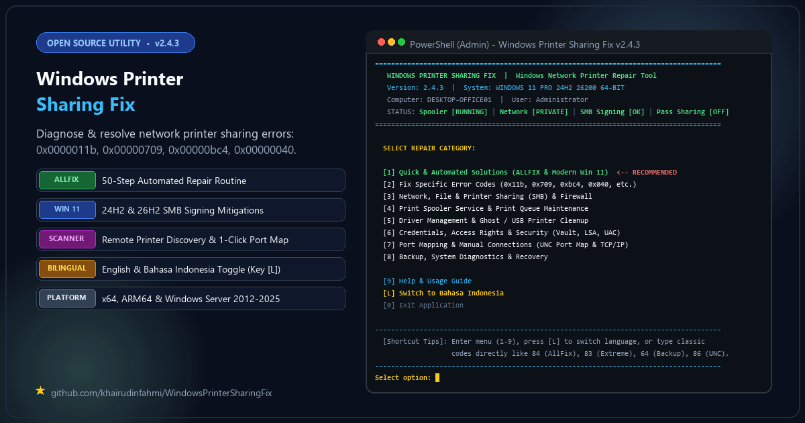
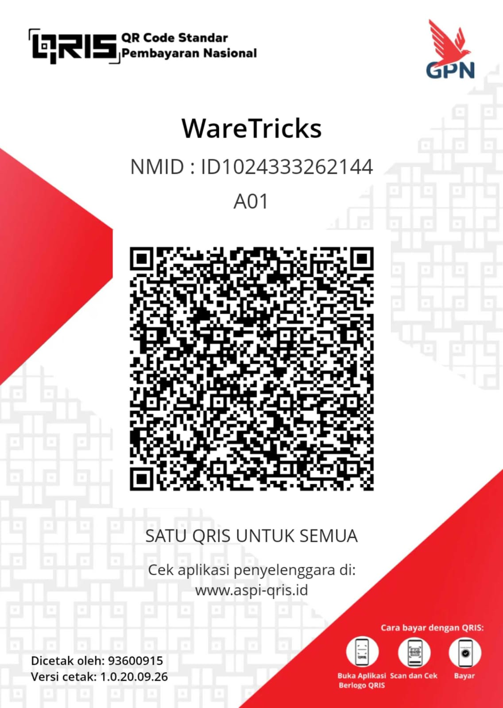

<div align="center">

  <h1>Windows Printer Sharing Fix</h1>

  <p>
    <strong>Automated diagnostic & remediation suite for Windows network printer sharing, RPC protocol restrictions, and Print Spooler connectivity.</strong>
  </p>

  <p>
    <a href="https://github.com/khairudinfahmi/WindowsPrinterSharingFix/releases"></a>
    <a href="https://github.com/khairudinfahmi/WindowsPrinterSharingFix/releases/tag/v2.4.1"></a>
    <a href="LICENSE"></a>
    <a href="https://github.com/khairudinfahmi/WindowsPrinterSharingFix"></a>
  </p>

  <p>
    <a href="https://github.com/khairudinfahmi/WindowsPrinterSharingFix/stargazers"></a>
    <a href="https://github.com/khairudinfahmi/WindowsPrinterSharingFix/network/members"></a>
    <a href="https://github.com/khairudinfahmi/WindowsPrinterSharingFix/issues"></a>
    <a href="https://github.com/khairudinfahmi/WindowsPrinterSharingFix"></a>
    <a href="https://github.com/khairudinfahmi/WindowsPrinterSharingFix"></a>
  </p>

  <p>
    <a href="#quick-start-guide"><b>Quick Start</b></a> •
    <a href="#option-1-official-windows-installer-recommended"><b>Download Installer</b></a> •
    <a href="#instant-error-code-quick-lookup-matrix"><b>Instant Error Matrix</b></a> •
    <a href="#option-4-unattended-cli-switches-automation--rmm"><b>CLI Automation</b></a> •
    <a href="https://github.com/khairudinfahmi/WindowsPrinterSharingFix/releases/tag/v2.4.1"><b>Release Notes</b></a>
  </p>

  <br>

  

</div>

> ⭐ **Found this helpful?** If this utility fixed your office printer sharing or saved you hours of troubleshooting, please **give this repository a Star**! It helps more sysadmins, IT technicians, and home office users discover this project.

**Windows Printer Sharing Fix** is a fully automated PowerShell utility that diagnoses and fixes printer sharing and network printing failures on Windows networks (Workgroups and Active Directory domains).

Simple enough for general office use, but ships with detailed diagnostics and targeted fix modules for IT admins, sysadmins, and field engineers.

Fully supports **Windows 10**, **Windows 11 (including 24H2, 25H2, 26H2+)**, **ARM64**, and **Windows Server 2016 / 2019 / 2022 / 2025**.

---

## Key Features

1. **Bilingual Interface (English & Indonesian)**:
   - Toggle the interface language anytime by pressing **`[L]`** at any menu or prompt.
   - Your language preference is saved in the registry (`HKCU:\Software\WindowsPrinterSharingFix\Language`).
2. **Real-Time System Health Banner**:
   - The header displays the live status of the 4 core Windows printer sharing components every time a menu opens:
     ```text
     STATUS: Spooler [RUNNING] | Network [PRIVATE] | SMB Signing [OK] | Pass Sharing [OFF]
     ```
   - Lets you spot network misconfigurations immediately.
3. **Clean Console Menu Layout**:
   - Sized for standard 86-column console buffers with **8 categorized submenus + 1 interactive help system**.
4. **Targeted Host vs Client Fixes**:
   - **Host PC Playbook (`[3]` in Submenu 1)**: For the computer physically connected to the printer via USB.
   - **Client PC Playbook (`[4]` in Submenu 1)**: For client computers connecting over the network.
5. **Windows 11 Security Compatibility (RPC & SMB)**:
   - Fixes modern RPC over Named Pipes restrictions (`RpcOverNamedPipes`, `RegisterSpoolerRemoteRpcEndPoint`).
   - Fixes mandatory SMB Signing blocks introduced in Windows 11 24H2.
   - Configures NTLMv2 fallback for local office Workgroups.
6. **Direct Action Shortcuts**:
   - Run any module directly from the Main Menu by number (e.g., `84` for ALLFIX, `83` for Extreme Path, `86` for UNC Port Mapping, `31` for Spooler Reset).
7. **Network Printer Scanner & 1-Click UNC Port Mapping**:
   - Fast, non-blocking network printer scanner with dual-tier discovery (SMB + RPC).
   - Selecting a printer automatically copies its UNC path (`\\HOST\PRINTER`) to the Windows Clipboard and offers 1-click local port mapping to bypass Error 0x00000709.
8. **CLI Automation & Diagnostic Operational Modes**:
   - Execute unattended playbooks (`-AllFix`, `-ExtremePath`, `-SilentAllFix`, `-NoPause`) or dry-run inspection modes (`-Verify`, `-Plan`, `-Analyze`, `-Audit`) with standard exit codes (`0` = healthy, `1` = drift/action needed).

---

## What's New in Version 2.4.1

1. **Fixed morning printer connection drops after cold boot**:
   - Fixed an issue where computers powered on in the morning couldn't connect to shared printers because the Spooler service started before Wi-Fi or LAN finished connecting. Added a lightweight logon task (`PrinterFixLogonReconnect`) that wakes up the network session (`\\Host\IPC$`) and refreshes Spooler when the user logs in.
   - The boot fix script (`PrinterFixReapply.ps1`) now performs a clean restart of the Spooler service (`Restart-Service spooler -Force`) during startup so boot-time RPC policies take effect immediately.
   - Fixed Windows resetting the default printer overnight: purged the temporary `SessionDefaultDevices` registry key and locked `UserSelectedDefault = 1` and `LegacyDefaultPrinterMode = 1` across all local user profiles (`HKU\S-1-5-21-*`).
   - Enabled NetBIOS over TCP/IP (`NetbiosOptions = 1`) on active network adapters in fix `0x00000040`.
   - Disabled network card power saving (Energy Efficient Ethernet / Green Ethernet) and USB Selective Suspend so idle computers don't drop printer connections overnight.
   - Saved printer credentials to both the user account and the `SYSTEM` vault (binding IP and hostname together) so background print jobs don't get authentication errors.
   - Set the network watchdog task duration (`/du 9999:59`) so Windows 11 doesn't automatically stop it after 24 hours.
   - Added an explicit exit in silent AllFix (`-SilentAllFix` / `-nuke`) so it reboots immediately without waiting for user input.

2. **Added CLI switches and diagnostic modes**:
   - Added command-line switches: `-AllFix`, `-ExtremePath`, `-SilentAllFix`, `-Diagnose`, `-Language EN|ID`, `-NoPause`.
   - Added read-only diagnostic modes: `-Verify` (checks 41 registry settings and services), `-Plan` (dry-run showing all 50 steps without changing anything), `-Analyze` (compares current settings against recommended values), and `-Audit` (saves full diagnostic report to the backup folder).
   - Added `-Debug` mode to print readback verification checks after each registry change.
   - All switches are automatically forwarded when the script requests Administrator elevation via UAC. Read-only modes (`-Verify`, `-Plan`, `-Analyze`, `-Audit`) can run without admin privileges.

3. **Automatic Spooler crash recovery via Windows SCM**:
   - Configured the Windows Service Control Manager (`sc.exe failure spooler`) to automatically restart Spooler in 2 seconds if it crashes, with zero background CPU overhead.
   - Added boot persistence for SCM recovery in `PrinterFixReapply.ps1` so Windows Updates don't overwrite it.

4. **Cleaner console output and cleaner logs**:
   - Removed duplicate log lines across companion fix routines.
   - Suppressed harmless DISM and service restart warnings (`3>$null`).
   - Isolated event log parsing to errors that happened during the current session, ignoring old historical errors.
   - Consolidated ALLFIX into 50 clean, non-repeating steps.

5. **Spooler Watchdog toggle**:
   - Added option `[90]` and updated menu `[4] -> [3]` to easily remove or toggle the 5-minute watchdog task.

6. **Fixed startup crash when run without admin rights**:
   - Moved helper functions (`Pause-User`, `Clear-Screen`) before the admin check so the script doesn't throw an error when asking for elevation.

7. **Auto-restore missing mscms.dll (Error 0x0000007e)**:
   - Fix `0x0000007e` now automatically copies missing `mscms.dll` from `System32`/`SysWOW64` into printer driver directories (`x64\3` and `W32X86\3`), fixing driver load errors on mixed 32-bit and 64-bit networks.

8. **Fixed date format bug in session logs**:
   - Normalized timestamp parsing in AllFix post-run check to handle both dot (`.`) and colon (`:`) separators across different Windows regional settings.

9. **Repaired ARM64 V4 Print Class Drivers**:
   - Extended `Fix-V4ClassDriver` to check and fix corrupted Version-4 driver keys under `Windows ARM64\Drivers\Version-4`.

10. **Immediate Spooler restart after registry changes**:
    - Modules `0x00000bc4`, `0x000006d1` (CSR), and Named Pipes now restart Spooler immediately so you don't need to manually reboot.

11. **Offline documentation auto-fetch**:
    - Option `[9] -> [2]` now automatically downloads and opens the HTML documentation in your browser when running via the one-liner command (`irm | iex`).

12. **Fixed scheduled task quote escaping**:
    - Fixed quotation escaping in `schtasks.exe` arguments for `PrinterFixNetworkWatchdog` to prevent syntax errors.

13. **Donation info and QRIS support**:
    - Added QRIS and crypto addresses (BTC, ETH, SOL) in README and documentation.

14. **Bilingual message cleanup**:
    - Standardized all network and discovery messages to match the selected language (English / Indonesian).

---

## Quick Start Guide

### Option 0: One-Liner Web Launch (Instant - No Download Required)
Open PowerShell as Administrator (`Win + X` -> **Terminal (Admin)** or **Windows PowerShell (Admin)**) and paste:
```powershell
irm https://raw.githubusercontent.com/khairudinfahmi/WindowsPrinterSharingFix/main/src/WindowsPrinterSharingFix.ps1 | iex
```
*This streams and executes the latest signed release directly in memory without modifying your disk.*

### Option 1: Official Windows Installer (Recommended)
1. Download `WindowsPrinterSharingFix_Installer.exe` from the latest [GitHub Release](https://github.com/khairudinfahmi/WindowsPrinterSharingFix/releases).
2. Run the installer wizard (includes Start Menu shortcuts, Desktop launcher, and automated uninstaller).
3. Launch **Windows Printer Sharing Fix** from your Desktop (automatically elevates to Administrator).

### Option 2: Portable Executable (.EXE)
1. Download `WindowsPrinterSharingFix.exe` from [GitHub Releases](https://github.com/khairudinfahmi/WindowsPrinterSharingFix/releases).
2. Right-click the file and select **Run as Administrator**.

### Option 3: Direct PowerShell Execution
Launch an elevated PowerShell prompt (Run as Administrator) and run:
```powershell
Set-ExecutionPolicy -Scope Process -ExecutionPolicy Bypass -Force
& ".\src\WindowsPrinterSharingFix.ps1"
```

### Option 4: Unattended CLI Switches (Automation & RMM)
Execute specialized playbooks directly via command line:
```powershell
# Run the complete 50-step ALLFIX playbook unattended
.\WindowsPrinterSharingFix.exe -AllFix

# Run ALLFIX silently and automatically reboot the system upon completion
.\WindowsPrinterSharingFix.exe -SilentAllFix

# Execute the modern Windows 11 24H2/25H2/26H2 remediation playbook
.\WindowsPrinterSharingFix.exe -ExtremePath

# Quick read-only verification of 41 registry settings, network profiles & services
.\WindowsPrinterSharingFix.exe -Verify

# Dry-run of all 50 ALLFIX steps without making changes
.\WindowsPrinterSharingFix.exe -Plan

# Analyze registry drift and print targeted recommendations
.\WindowsPrinterSharingFix.exe -Analyze

# Full system audit saved to backup directory
.\WindowsPrinterSharingFix.exe -Audit

# Run fixes with verbose readback verification
.\WindowsPrinterSharingFix.exe -Debug

# Run full system diagnostics and export an interactive HTML report
.\WindowsPrinterSharingFix.exe -Diagnose

# Unattended automation for monitoring (Nagios/Zabbix/RMM): exit 0 if healthy, 1 if drift
.\WindowsPrinterSharingFix.exe -Verify -NoPause

# Unattended remediation without confirmation prompts
.\WindowsPrinterSharingFix.exe -AllFix -NoPause

# Launch in English explicitly
.\WindowsPrinterSharingFix.exe -Language EN
```

---

## Instant Error Code Quick-Lookup Matrix

Quickly identify your Windows network printer error code and match it to its root cause, security policy, and direct resolution:

| Error Code / Symptom | Exact Windows Error Message | Root Cause & Security Policy | Recommended Action / CLI Switch |
| :--- | :--- | :--- | :--- |
| **0x0000011b** | *Operation failed with error 0x0000011b* | RPC authentication level requirement (`CVE-2021-1678`) introduced by Windows security updates. | Run `[01]` or `.\WindowsPrinterSharingFix.exe -AllFix` |
| **0x00000709** / **0x00000006** / **0x7c** | *Operation could not be completed (error 0x00000709 / 0x00000006)* | Point and Print driver elevation requirement, stale connection ghost handles (`ERROR_INVALID_HANDLE`), or RPC named pipes binding refusal. | Run `[02]`, `[56]`, or UNC Port Mapping `[86]` |
| **0x00000bc4** | *No printers were found* | Windows 11 default RPC connection protocol restricted to TCP rather than Named Pipes. | Run `[03]` (Forces `RpcUseNamedPipeProtocol = 1`) |
| **0x00000040** | *The specified network name is no longer available* | Stale SMB keep-alive sessions, socket timeout, or driver provider disconnection. | Run `[07]` (Sets `KeepConn=65535` & extends timeouts) |
| **SMB Signing Refusal** | *You can't access this shared folder because your organization's security policies block unauthenticated guest access* | Windows 11 24H2/25H2 mandatory SMB signing requirement (`RequireSecuritySignature`). | Run `[16]` or `.\WindowsPrinterSharingFix.exe -ExtremePath` |
| **0x80070035** | *The network path was not found* | Function Discovery Resource Publication (`FDResPub`) or SSDP discovery services disabled. | Run `[04]` or `[20]` (Starts discovery stack) |
| **0x000006d1** | *Windows cannot connect to the printer (0x000006d1)* | Client-Side Rendering (CSR) crash during spooling over network. | Run `[05]` (Sets `DisableClientSideRendering = 1`) |
| **0x80070005** | *Access is denied* | Insufficient NTFS / Spooler ACL permissions on `System32\Spool\Printers`. | Run `[06]` (Grants universal `Everyone` queue ACL) |
| **0x00000002** | *The system cannot find the file specified* | Point & Print CopyFilesPolicy ingestion restriction blocking remote driver transfer. | Run `[08]` (Enables `UseSharedSpooler = 1`) |
| **0x0000007e** | *The specified module could not be found* | Cross-architecture (32-bit client to 64-bit server) driver bitness mismatch. | Run `[09]` (Injects architecture compatibility keys) |
| **Morning Disconnection** | *Printer offline after morning computer boot* | Spooler starts before Wi-Fi/DHCP network attachment completes. | Run `.\WindowsPrinterSharingFix.exe -AllFix` (deploys `PrinterFixLogonReconnect`) |

---

## Menu & Submenu Reference (v2.4.1)

The main console provides 90 direct execution module codes (`1`–`90`), structured into 8 dedicated categories (73 interactive submenu options) plus an interactive help engine:

<p align="center">
  
</p>

```text
======================================================================================
   WINDOWS PRINTER SHARING FIX  |  Windows Network Printer Repair Tool
   Version: 2.4.1  |  System: WINDOWS 11 PRO 24H2 26200 64-BIT
   Computer: DESKTOP-OFFICE01  |  User: Administrator
   STATUS: Spooler [RUNNING] | Network [PRIVATE] | SMB Signing [OK] | Pass Sharing [OFF]
======================================================================================

  [1] Quick & Automated Solutions (ALLFIX & Modern Win 11)
  [2] Fix Specific Error Codes (0x11b, 0x709, 0xbc4, 0x040, etc.)
  [3] Network, File & Printer Sharing (SMB) & Firewall
  [4] Print Spooler Service & Print Queue Maintenance
  [5] Driver Management & Ghost / USB Printer Cleanup
  [6] Credentials, Access Rights & Security (Vault, LSA, UAC)
  [7] Port Mapping & Manual Connections (UNC Port Map & TCP/IP)
  [8] Backup, System Diagnostics & Recovery
  [9] Help & Usage Guide

  [L] Switch Language (English / Indonesia)
  [?] Display Module Help (e.g., ? 84 or help 86)
  [0] Exit Application
```

---

### Submenu 1: Quick & Automated Solutions (ALLFIX & Modern Win 11)
One-click fix routines that cover the most common and complex sharing failures.

| # | Menu Option (Exact Console String) | Code | Technical Description & Scope |
| :---: | :--- | :---: | :--- |
| **1** | **ALLFIX - Run 50 Automated Fixes Simultaneously** | `[84]` | **Primary Recommendation**: Runs 50 successive repair steps across registry, Group Policy, RPC, SMB, firewall, and spooler. Resolves 98% of office network printing issues. |
| **2** | **Extreme Path for Modern Windows 11 (24H2 / 25H2 / 26H2 & ARM64)** | `[83]` | Deploys deep hardening mitigations for recent Windows 11 builds: enables RPC over Named Pipes, relaxes strict SMB signing, and configures non-domain Kerberos fallback. |
| **3** | **Optimize Host / Print Server PC (Connected directly to printer)** | `Playbook` | Dedicated playbook for the PC physically connected to the printer: enables remote RPC spooler endpoint, sets Private network, opens guest access, configures firewall/WSD, and configures Native SCM auto-recovery. |
| **4** | **Optimize Client PC (Connecting to shared printer over network)** | `Playbook` | Dedicated playbook for client PCs connecting to shared printers: enables RPC Named Pipes, bypasses Point & Print elevation, disables client SMB signing, and flushes DNS. |
| **5** | **Silent ALLFIX (Automated Fixes + Immediate Reboot)** | `[85]` | Executes the 50-step ALLFIX routine without interactive prompts and immediately reboots the computer upon completion (ideal for sysadmins and unattended deployment). |
| **6** | **Manage Windows Updates & Block Printer-Breaking Patches** | `[69]` | Pauses updates for 35 days, provides tools to roll back breaking cumulative updates, or toggles Windows Update services to protect working print configurations. |

---

### Submenu 2: Fix Specific Error Codes (0x11b, 0x709, 0xbc4, 0x040, etc.)
Targeted fix modules mapped to specific hexadecimal Windows network print error codes.

| # | Menu Option (Exact Console String) | Code | Root Cause & Technical Fix |
| :---: | :--- | :---: | :--- |
| **1** | **Error 0x0000011b - Patch RPC Authentication Block (RpcAuthnLevelPrivacy)** | `[01]` | Mitigates CVE-2021-1678 RPC authentication requirements by setting `RpcAuthnLevelPrivacyEnabled = 0` under `Control\Print`. |
| **2** | **Error 0x00000709 / 0x00000006 - Network Printer Connection & Invalid Handle (Point and Print / RPC)** | `[02]` | Resolves printer name/driver binding failures, purges stale HKCU connection ghost handles (`ERROR_INVALID_HANDLE`), sets `CopyFilesPolicy = 1`, and standardizes multi-layer RPC protocol bindings. |
| **3** | **Error 0x00000bc4 - No Printers Were Found (Enforce RPC Named Pipes)** | `[03]` | Fixes "No printers were found" by forcing `RpcUseNamedPipeProtocol = 1` and `RpcProtocols = 7` under Group Policy Printer overrides. |
| **4** | **Error 0x80070035 - Network Path Not Found (Initialize Discovery Services)** | `[04]` | Fixes "The network path was not found" by automating and starting Discovery services (`fdPHost`, `FDResPub`, `SSDPSRV`, `upnphost`). |
| **5** | **Error 0x000006d1 - Disable Client-Side Rendering (CSR)** | `[05]` | Fixes Client-Side Rendering (CSR) spooling crashes by setting `DisableClientSideRendering = 1`, shifting rendering directly to the host spooler. |
| **6** | **Error 0x80070005 - Access Denied to Spooler Folder (Reset Universal ACL Permissions)** | `[06]` | Resolves "Access Denied" on print queues by granting Full Control ACL permissions to universal `Everyone` (`S-1-1-0`) on `C:\Windows\System32\Spool\Printers`. |
| **7** | **Error 0x00000040 - Network Name Is No Longer Available (KeepConn & Ports)** | `[07]` | Fixes "The specified network name is no longer available" by configuring SMB `KeepConn = 65535`, extending session timeout to 300s, verifying print provider integrity, and clearing stale sessions without service disruption. |
| **8** | **Error 0x00000002 - Driver File Copy Policy Block (CopyFilesPolicy Ingestion)** | `[08]` | Resolves driver file copy errors during client connection by enabling `UseSharedSpooler = 1`. |
| **9** | **Error 0x0000007e - RPC Driver Bitness Mismatch (32-bit & 64-bit Systems)** | `[09]` | Fixes 32-bit and 64-bit cross-architecture driver mismatch errors by injecting RPC bitness compatibility registry keys. |

---

### Submenu 3: Network, File & Printer Sharing (SMB) & Firewall
Ensures underlying network connectivity, protocol compatibility, and firewall port clearance.

| # | Menu Option (Exact Console String) | Code | Details & Technical Benefit |
| :---: | :--- | :---: | :--- |
| **1** | **Switch Network Profile to Private (Required for printer sharing)** | `[11]` | Changes current network connection profile from Public to Private, enabling Windows sharing and file/printer discovery. |
| **2** | **Open Passwordless Sharing (Guest Access & Anonymous Sharing)** | `[12]` | Sets `AllowInsecureGuestAuth = 1`, `everyoneincludesanonymous = 1`, and `LimitBlankPasswordUse = 0` for local LAN access. |
| **3** | **Disable SMB Signing Requirement (Fix Win 11 connection to Printer/NAS)** | `[16]` | Disables `RequireSecuritySignature` on LanmanWorkstation and LanmanServer to resolve connection refusals on Windows 11 24H2+. |
| **4** | **Manage SMB Protocols (Ensure Modern SMB2/SMB3 & SMB 1.0 Settings)** | `[15] & [17]` | Manages modern SMB2/SMB3 protocol engines and provides an emergency toggle for legacy SMBv1 for vintage print equipment. |
| **5** | **Open Windows Firewall Rules for File & Printer Sharing (Including WSD Port 3702)** | `[14] & [21]` | Authorizes inbound TCP 445, 139, 135 and UDP 137, 138, 3702 (WSD), 5353 (mDNS) through Windows Defender Firewall. |
| **6** | **Enable Automatic Device Discovery (mDNS, LLMNR, and WSD Discovery)** | `[20] & [30]` | Starts the complete Windows discovery stack to ensure network printers appear in Windows Explorer and setup dialogs. |
| **7** | **Set Network Provider Order & Resolve Virtual Hyper-V/WSL Conflicts** | `[18] & [23]` | Prioritizes physical network adapters over virtual interfaces (Hyper-V, WSL, VMware, VPNs) to prevent routing confusion. |
| **8** | **Total Network & DNS Cache Refresh (Flush DNS, NetBIOS & SMB Session Purge)** | `[10] & [27]` | Safely flushes DNS cache, re-registers DNS, purges NetBIOS tables (`nbtstat -RR`), and clears stale SMB sessions without kernel-level stack resets. |
| **9** | **Disable IPv6 Protocol Stack (Use if office LAN is pure IPv4)** | `[19]` | Disables IPv6 binding on network adapters in pure IPv4 environments, preventing link-local resolution timeouts. |
| **10** | **Install IPP / Mopria Sharing Foundation & Legacy LPR/LPD Protocols** | `[22] & [24]` | Enables Internet Printing Protocol (IPP) and Unix LPR legacy port support for modern multi-function devices and industrial copiers. |

---

### Submenu 4: Print Spooler Service & Print Queue Maintenance
Resolves Print Spooler service crashes, clears jammed documents, and establishes automated self-healing.

| # | Menu Option (Exact Console String) | Code | Details & Technical Benefit |
| :---: | :--- | :---: | :--- |
| **1** | **Clean Spooler Reset & Purge Jammed Print Queue Files (.spl/.shd)** | `[31] & [37]` | Terminates hung spooler processes, deletes all corrupted print artifacts (`.spl` and `.shd`) from `PRINTERS`, and performs a clean restart. |
| **2** | **Configure Native Spooler Recovery on Crash (Auto-Restart in 2s via SCM)** | `[34]` | Configures Windows Service Control Manager to automatically restart Print Spooler in 2 seconds on crash with 0% CPU overhead. |
| **3** | **Deploy / Remove Spooler Watchdog Scheduled Task** | `[36] & [90]` | Smart toggle: Deploys 5-minute health check if absent, or cleanly removes `SpoolerWatchdog` from Task Scheduler if active (`[90]`). |
| **4** | **Repair & Reset Spooler Registry Dependencies (RPCSS & HTTP)** | `[35] & [38]` | Restores factory spooler dependencies (`RPCSS` and `http`), stripping corrupted third-party dependencies that prevent startup. |
| **5** | **Restart Core System RPC & DCOM Services** | `[32]` | Audits and verifies core RPC foundation services (`RpcSs`, `DcomLaunch`) to eliminate *"The RPC server is unavailable"* errors. |
| **6** | **Restart Remote Spooler Service on Target Computer** | `[33]` | Issues a remote spooler restart command across the network via PowerShell remoting/DCOM without requiring physical access. |

---

### Submenu 5: Driver Management & Ghost / USB Printer Cleanup
Manages driver locks, uninstalls legacy driver packages cleanly, and mitigates Windows 11 driver isolation issues.

| # | Menu Option (Exact Console String) | Code | Details & Technical Benefit |
| :---: | :--- | :---: | :--- |
| **1** | **Force-Kill Locking Driver Processes ('Driver is in use')** | `[44]` | Forcefully terminates `splwow64.exe`, `printfilterpipelinesvc.exe`, and driver isolation host processes holding locks on driver DLLs. |
| **2** | **Disable Print Driver Isolation (Prevent separate process crashes)** | `[40]` | Sets `IsolationPolicy = 0` under `Control\Print` to prevent driver isolation sandboxes from crashing during inter-process RPC calls. |
| **3** | **Clean Stale & Corrupted Drivers (Driver Sweeper via pnputil)** | `[43]` | Scans and uninstalls orphaned OEM print driver packages from the Windows Driver Store using native `pnputil`. |
| **4** | **Remove Ghost & Duplicate USB Printers (Copy 1, Copy 2, dead ports)** | `[45] & [46]` | Purges ghost printer instances ("Copy 1", "Copy 2") and unbinds stale virtual USB printer ports left by physical re-plugging. |
| **5** | **Repair Universal V4 Print Class Drivers & Switch PCL / PostScript Mode** | `[41] & [42]` | Reconfigures modern V4 print class drivers for network sharing and toggles driver rendering mode between RAW, PCL, and PostScript. |
| **6** | **Fix Web Browser Printing (Chrome/Edge Sandbox & Modern UWP Apps)** | `[47] & [49]` | Resolves blank or frozen print dialogs in Google Chrome, Microsoft Edge sandbox, and Windows Store UWP applications. |
| **7** | **Reinstall Windows Virtual Built-in Printers (Microsoft Print to PDF / XPS)** | `[48]` | Reinstalls missing system virtual print devices (*Microsoft Print to PDF* and *Microsoft XPS Document Writer*). |
| **8** | **Lock Default Printer Permanently (Prevent automatic location switching)** | `[50] & [51]` | Permanently locks preferred default printer in HKCU registry and disables automatic Windows default printer reassignment. |
| **9** | **Sanitize Printer Share Names (Strip spaces and illegal characters)** | `[53]` | Scans shared printer names and automatically strips spaces and illegal characters (`!@#$%^&*`) to prevent SMB network rejection. |
| **10** | **Open Print Server Properties Management Console** | `[39]` | Launches the native Windows Print Server Properties MMC management interface (`printui.exe /s2`) for advanced driver and form control. |
| **11** | **Force-Uninstall Specific Problematic Printer** | `[46]` | Interactive utility to force-remove a specific locked printer queue, clearing spooler locks and registry registrations. |

---

### Submenu 6: Credentials, Access Rights & Security (Vault, LSA, UAC)
Manages multi-machine authentication, Windows Vault credentials, and Windows 11 security policies.

| # | Menu Option (Exact Console String) | Code | Details & Technical Benefit |
| :---: | :--- | :---: | :--- |
| **1** | **Save Printer Credentials (Username & Password) to Windows Vault** | `[60]` | Writes target printer host credentials directly into the Windows Credential Manager (`cmdkey`) for persistent non-interactive access. |
| **2** | **Clean Stale/Outdated Printer Credentials from Windows Vault** | `[61]` | Scans and deletes expired or invalid printer host credentials stored in Windows Vault to resolve persistent "Access Denied" errors. |
| **3** | **Deploy Login Credentials to All User Profiles on This Machine** | `[63]` | Replicates network printer authentication tokens across all user profiles on the workstation via multi-user RunOnce deployment. |
| **4** | **Bypass Administrator UAC Network Token Filter for Workgroups** | `[57]` | Sets `LocalAccountTokenFilterPolicy = 1` to prevent Windows from stripping administrative tokens during remote network access in Workgroups. |
| **5** | **Align NTLMv2 Authentication Response (LmCompatibilityLevel)** | `[58]` | Configures `LmCompatibilityLevel = 2` or `3` to align NTLM authentication across heterogeneous Windows versions. |
| **6** | **Relax Strict Security Protections (LSA Protection, Smart App Control, Credential Guard)** | `[54], [55], [62]` | Relaxes strict enterprise security mitigations (LSA RunAsPPL, SAC, and Credential Guard) that block legacy NTLM authentication on Workgroups. |
| **7** | **Manage Windows Protected Print / WPP (Win 11 Driver Mode)** | `[59]` | Configures Windows 11 Windows Protected Print (WPP) mode to prevent blocking legacy third-party V3 printer drivers. |
| **8** | **Bypass Point and Print Driver Restrictions (Elevation Override)** | `[56]` | Bypasses Point and Print driver installation elevation requirements (CVE-2021-34527 PrintNightmare mitigations) without disabling driver validation. |
| **9** | **Fix Printer Redirection on Remote Desktop Connections (RDP)** | `[52]` | Restores client printer redirection inside Remote Desktop sessions by correcting Terminal Services registry configuration keys. |

---

### Submenu 7: Port Mapping & Manual Connections (UNC Port Map & TCP/IP)
Direct connection methods when standard Windows Network Discovery fails.

<p align="center">
  
</p>

| # | Menu Option (Exact Console String) | Code | Details & Technical Benefit |
| :---: | :--- | :---: | :--- |
| **1** | **Map Local Port to UNC Share (Auto-Scan or Manual Bypass for Error 0x00000709)** | `[86]` | Ultimate workaround for error 0x00000709: supports auto-scanning remote hosts to pick printers from a live list (zero manual typing) or direct manual UNC input. Injects Local Port, restarts Spooler, and auto-copies UNC to clipboard. |
| **2** | **Remove Previously Created Local UNC Port Mapping** | `[87]` | Cleans up and unbinds previously created local UNC port mappings from the print spooler. |
| **3** | **Convert WSD Printer Port to Stable Standard TCP/IP Socket** | `[26]` | Converts unreliable WSD (Web Services on Devices) ports to standard Raw TCP/IP ports (Port 9100) to eliminate phantom offline status. |
| **4** | **Add Standard TCP/IP Printer Port Manually** | `[29]` | Creates a direct Raw TCP/IP printing port (Port 9100) using the target printer's static IP address via WMI. |
| **5** | **Scan & Discover Shared Printers on Network (Live Network Discovery)** | `[25]` | Performs fast non-blocking reachability probe (< 1s timeout) on ports 445/135, discovers shared printers via dual-tier SMB/RPC engine, displays an interactive numbered list with real-time `[ONLINE]` status, automatically copies selected UNC paths, and enables 1-click local port mapping. |

---

### Submenu 8: Backup, System Diagnostics & Recovery
Safety mechanisms to back up system state prior to modifications and deep diagnostic analysis tools.

| # | Menu Option (Exact Console String) | Code | Details & Technical Benefit |
| :---: | :--- | :---: | :--- |
| **1** | **Backup Printer & Network Registry (Always Recommended Before Fixes)** | `[64]` | Exports 5 critical registry hives (`Print`, `PrintersPolicy`, `LanmanWorkstation`, `LanmanServer`, `Lsa`) to `C:\WindowsPrinterSharingFixBackup`. |
| **2** | **Rollback Registry from Previous Backup Snapshot** | `[65]` | Re-imports the backup `.reg` hives to restore original system state whenever needed. |
| **3** | **Create System Restore Point for System Rollback** | `[66]` | Generates an immediate Windows System Restore Point with automatic frequency-limit bypass. |
| **4** | **Scan & Repair System Files (SFC /scannow & DISM)** | `[67]` | Runs `sfc /scannow` and `dism /online /cleanup-image /restorehealth` to repair corrupted Windows core components. |
| **5** | **Test Network Connectivity & Scan Ports (Ping & Port 135/445)** | `[74]` | Performs raw ICMP echo and TCP socket handshakes on Port 445 (SMB) and Port 135 (RPC) to verify network route and firewall clearance. |
| **6** | **Audit & Analyze Print Service Event Logs (Event Log Parser)** | `[76] & [78]` | Inspects Windows Event Logs for print service errors and maps event IDs to specific recommended fixes. |
| **7** | **Generate Interactive HTML Diagnostic Report** | `[79]` | Compiles hardware, network, spooler, driver, and registry status into a standalone interactive HTML diagnostic report. |
| **8** | **Scan Active Directory Domain Policy / GPO Intervention** | `[80]` | Detects whether active Domain Group Policy Objects (GPO) are overriding local printer sharing registry configurations. |
| **9** | **Backup & Migrate Printers to Another Computer (PrintBRM)** | `[81]` | Backs up or migrates complete printer queues, driver packages, and ports across computers using native Windows `PrintBRM.exe`. |
| **10** | **Force Printer Status to 'Online' (If stuck offline)** | `[71]` | Sends WMI instructions to clear hung error flags on print queues and force offline printers back to *Online* state. |
| **11** | **Open Windows Services Console (services.msc)** | `[72]` | Launches the native Windows Services Management Console (`services.msc`) for manual service management. |
| **12** | **Open Repair Execution Log File (Log Manager)** | `[75]` | Opens the live execution audit log (`C:\WindowsPrinterSharingFixLog.txt`) in Notepad for review. |
| **13** | **Quick System Diagnostics Audit** | `[77]` | Runs a rapid health audit covering Spooler state, network profile, SMB signing status, and password sharing configuration. |

---

### Submenu 9: Help & Usage Guide
Built-in technical reference, diagnostic tools, and usage guidance for every module.

| # | Menu Option (Exact Console String) | Code | Details & Technical Benefit |
| :---: | :--- | :---: | :--- |
| **1** | **Show Quick Guide & Office Troubleshooting Flow** | `[Help]` | Displays an interactive terminal guide detailing standard operating procedures for resolving office printer sharing problems. |
| **2** | **Open Offline HTML Documentation in Browser** | `[HTML]` | Launches the complete interactive offline HTML documentation (`docs/documentation.html`) in your default web browser. |
| **3** | **Detect Current Windows Version & Architecture** | `[73]` | Audits and displays Windows version, build number, architecture (x64/ARM64), and feature update release code. |
| **4** | **Run Windows Built-in Printer Troubleshooter (msdt)** | `[70]` | Launches the native Microsoft Support Diagnostic Tool (`msdt.exe`) printer troubleshooting wizard. |

---

## Under the Hood: Resilience and Persistence

When automated playbooks (**ALLFIX [84]** or **Extreme Path [83]**) are executed, the engine applies multiple safety and persistence mechanisms:

1. **Pre-Change Registry Backup**: Backs up 5 critical registry hives to `C:\WindowsPrinterSharingFixBackup` before making any modifications.
2. **Group Policy Synchronization (`gpupdate /force`)**: Refreshes local Group Policy before writing registry overrides to prevent immediate policy rollback.
3. **Resilient Scheduled Tasks (Boot & Logon)**:
   - `PrinterFixPostUpdate` (triggered on system boot with a 30-second polling retry loop): Re-applies critical RPC, SMB guest, and Point & Print policies if monthly Windows Updates (*Patch Tuesday*) revert configurations.
   - `PrinterFixLogonReconnect` (triggered on user logon): Wakes up the network session (`\\Host\IPC$`) and refreshes Print Spooler so cold-booted computers connect reliably before background networking finishes.
   - `PrinterFixNetworkWatchdog` (runs every 15 minutes): Automatically detects and restores network profiles to `Private` if adapter reconnections or router reboots temporarily drop them to `Public`.
   - `SpoolerWatchdog` (optional, runs every 5 minutes): Actively monitors the Print Spooler service and restarts it if terminated by unstable third-party drivers (toggleable via menu `[4] -> [3]` or shortcut `[90]`).
   - *All scheduled tasks are configured with battery exemption (`AllowStartIfOnBatteries`, `DontStopIfGoingOnBatteries`) to maintain protection on laptops without battery drain.*
4. **Automatic Spooler Crash Recovery (SCM)**: Configures the Windows Service Control Manager (`sc.exe failure spooler`) to instantly restart Print Spooler in 2 seconds upon crash without background polling overhead.
5. **Clean Session & Ticket Eviction**: Executes `klist purge`, `ipconfig /flushdns`, and `nbtstat -RR` to flush stale NetBIOS names, expired Kerberos tickets, and cached DNS entries.

---

## Frequently Asked Questions (FAQ & Troubleshooting)

### Why does Windows 11 24H2 refuse to connect to my Windows 10 shared printer?
Starting with Windows 11 Version 24H2, Microsoft enforced mandatory **SMB Signing** (`RequireSecuritySignature`) by default on all client editions and blocked unauthenticated guest logons. When connecting to a Windows 10 host or older NAS that does not require SMB signing, Windows 11 drops the connection with errors such as *"The specified network name is no longer available"* or *"Your organization's security policies block unauthenticated guest access"*. Executing **Extreme Path `[83]`** or **Option 3 in Submenu 3 `[16]`** relaxes client signing requirements and restores transparent Workgroup printer connectivity.

### Do I need to run this tool on the Host PC, the Client PC, or both?
- **Host PC (physically connected to the printer)**: Run **Submenu 1 -> Option [3] (Printer Host Playbook)**. This opens RPC spooler endpoints, sets your network profile to Private, configures firewall rules, and starts discovery services.
- **Client PC (connecting over the network)**: Run **Submenu 1 -> Option [4] (Client Workstation Playbook)**. This forces RPC over Named Pipes (`0x00000bc4` fix), bypasses Point and Print driver elevation requirements (`0x00000709` fix), and disables client SMB signing restrictions.
- **Whole Office / Workgroup**: Running **ALLFIX `[84]`** on both host and client machines guarantees complete configuration alignment and resolves 98% of office network printing issues.

### Will my printer sharing settings survive monthly Windows Updates (Patch Tuesday)?
Yes. Windows Printer Sharing Fix registers the lightweight `PrinterFixPostUpdate` boot verification trigger. Whenever cumulative Windows Updates (e.g., KB5005565, KB5005568, KB5006670, or subsequent patches) replace system DLLs or reset registry keys, the trigger re-applies critical sharing configurations automatically on system restart without disruptive mid-day restarts.

### How does this utility compare to older 2021 PrintNightmare batch scripts?
Legacy batch scripts from 2021 typically only set a single registry key (`RpcAuthnLevelPrivacyEnabled = 0`) which was patched and superseded by newer Windows cumulative updates. They cannot resolve modern Windows 11 24H2/25H2 SMB Signing restrictions, RPC Named Pipes overrides (`0x00000bc4`), Point and Print driver copy policy blocks (`0x00000002`), or socket keep-alive resets (`0x00000040`). This utility contains 90 specialized repair modules designed for current Windows 10, 11, and Server 2025 releases.

### Why does my shared printer keep disconnecting or showing offline every morning?
Windows Print Spooler often starts before wireless (Wi-Fi) or dynamic DHCP Ethernet connections are fully established during morning cold boots, causing Windows to fail the network IPC handshake (`\\Host\IPC$`) and mark the printer as offline. Running **ALLFIX `[84]`** deploys the lightweight `PrinterFixLogonReconnect` scheduled task, which automatically pings the IPC share and refreshes the Print Spooler upon user login without requiring manual reboots or IT assistance.

---

## Building and Compiling from Source

### Prerequisites
- Windows 10 / 11 / Server (x64 or ARM64)
- PowerShell 5.1+
- Inno Setup 6 (for building the installer)

### Compile Portable Executable & Setup Installer
```powershell
powershell -ExecutionPolicy Bypass -File build\Compile-ToExe.ps1
```
This builds `release\WindowsPrinterSharingFix.exe`, generates `release\WindowsPrinterSharingFix_Installer.exe` using Inno Setup, bundles the latest offline documentation, and applies Authenticode digital signatures to both executables.

---

## Support & Donations

If **Windows Printer Sharing Fix** helped resolve your network printing issues or saved your office troubleshooting time, consider supporting ongoing maintenance:

<p align="left">
  
  
  
  
</p>

### 1. Indonesian Domestic Payment (QRIS)
Supports all Indonesian mobile banking applications and digital e-wallets (BCA, Mandiri, BRI, BNI, CIMB, GoPay, OVO, Dana, ShopeePay):

<details>
  <summary><b>Click to view QRIS payment barcode</b></summary>
  <br>
  <p align="center">
    
  </p>
</details>

### 2. Cryptocurrency Wallets
Click the copy button on the right side of each address box below to copy directly:

#### Bitcoin (BTC)
*Network: Native SegWit (BTC)*
```text
bc1qdyw2j97femzh32zrjc45rkew6q244atf8p8gpv
```

#### Ethereum & EVM Chains (ETH, BNB, USDT, USDC)
*Supported Networks: Ethereum, BNB Smart Chain, Arbitrum, Base, Linea, Polygon*
```text
0x36e17e832a5eE64403A432d0D6dE0fc92C47A479
```

#### Solana (SOL)
*Network: Solana Mainnet*
```text
26kFkv96Mn2bPzZM8KLqforDaQcRntLaW8AAGsWBEsbD
```

---

## License and Contribution

This project is licensed under the **GNU General Public License v3.0 (GPL-3.0)**. Free to use, modify, and distribute for both personal and enterprise environments.

Contributions and feedback are welcome! Please submit bug reports or feature requests via [GitHub Issues](https://github.com/khairudinfahmi/WindowsPrinterSharingFix/issues) or submit a Pull Request following our [CONTRIBUTING.md](CONTRIBUTING.md).

